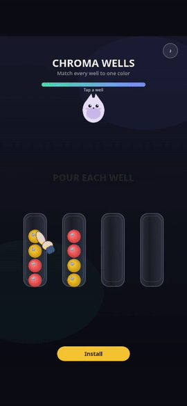
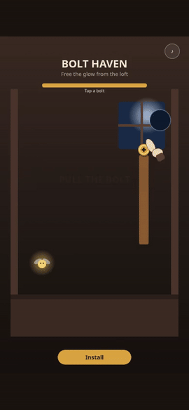
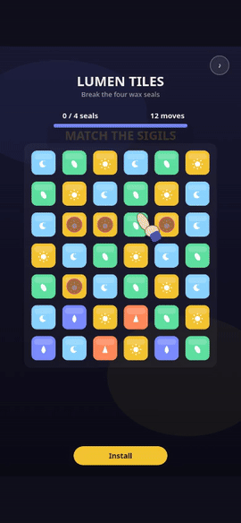

# Ora Playables

Ready-made HTML5 playable ads you can try in the browser, then buy with USDT on BNB Smart Chain. Payment is forwarded straight to the seller’s wallet; a few seconds later you get a download with your App Store or Google Play link already wired in.

[Play the demos](https://lyp1314.github.io/playable-ads-portfolio/) · [Buy with USDT](https://lyp1314.github.io/playable-ads-portfolio/buy.html) · [Contract (Sourcify)](https://repo.sourcify.dev/56/0x6ee40eD93128db7022924980272101f9936bd334)

三则原创可试玩广告，打开即可玩。付 USDT 后会自动发货，下载文件里已经换成你的应用商店链接。

## Try them first

Each demo is one self-contained HTML file (~22–25 KB), 720×1280, no external images, fonts, or audio.

<table>
  <tr>
    <td align="center" width="33%">
      <a href="https://lyp1314.github.io/playable-ads-portfolio/demos/chroma-wells.html"></a>
      <br><strong>Chroma Wells</strong><br>Ball sort / 倒球分色
      <br><a href="https://lyp1314.github.io/playable-ads-portfolio/demos/chroma-wells.html">Play</a> · <a href="https://lyp1314.github.io/playable-ads-portfolio/buy.html?game=chroma-wells">Buy</a>
    </td>
    <td align="center" width="33%">
      <a href="https://lyp1314.github.io/playable-ads-portfolio/demos/bolt-haven.html"></a>
      <br><strong>Bolt Haven</strong><br>Pin pull / 拔钉救援
      <br><a href="https://lyp1314.github.io/playable-ads-portfolio/demos/bolt-haven.html">Play</a> · <a href="https://lyp1314.github.io/playable-ads-portfolio/buy.html?game=bolt-haven">Buy</a>
    </td>
    <td align="center" width="33%">
      <a href="https://lyp1314.github.io/playable-ads-portfolio/demos/lumen-tiles.html"></a>
      <br><strong>Lumen Tiles</strong><br>Match-3 / 三消
      <br><a href="https://lyp1314.github.io/playable-ads-portfolio/demos/lumen-tiles.html">Play</a> · <a href="https://lyp1314.github.io/playable-ads-portfolio/buy.html?game=lumen-tiles">Buy</a>
    </td>
  </tr>
</table>

| Template | Mechanic | Highlight | Size |
| --- | --- | --- | --- |
| [Chroma Wells](demos/chroma-wells.html) | Pour and sort balls across two rounds | Enter the Deep Well; a full well flares | 24.5 KB |
| [Bolt Haven](demos/bolt-haven.html) | Pull bolts in order to free someone | A block slams onto the wooden frame | 21.5 KB |
| [Lumen Tiles](demos/lumen-tiles.html) | Match-3 to break a wax seal, 12 moves | A 4- or 5-match triggers AURORA slow motion | 24.1 KB |

Shared structure: a looping hint hand before the first tap, Web Audio after the first click, the hint again after 2.5 s idle, an end card after 10 s idle (CLEARED or ALMOST), and an Install button both on the end card and along the bottom. Change the `STORE_URL` constant at the top of the file to point at a real store listing.

## Pricing

The download is the same file at every tier. What changes is the license.

| Tier | Price | License |
| --- | --- | --- |
| Basic | 5 USDT | Testing or a single campaign |
| Standard | 7 USDT | Commercial use, one app |
| Premium | 9 USDT | Commercial use, unlimited apps |

Pay on [the checkout page](https://lyp1314.github.io/playable-ads-portfolio/buy.html). Only USDT on BNB Smart Chain (BSC) is accepted.

## How delivery works

1. On the checkout page, pick a template and a tier, and paste your App Store or Google Play URL.
2. Connect a wallet and pay the listed amount in USDT. A short contract (`PlayablePay`, [verified on Sourcify](https://repo.sourcify.dev/56/0x6ee40eD93128db7022924980272101f9936bd334)) forwards the payment to the seller and emits an on-chain receipt. The contract does not hold funds.
3. A small delivery service watches the chain. After confirmations it rewrites the `STORE_URL` in the template (escaped) and returns a download link on the same page, usually within a few seconds.

No account is required. If the delivery service is temporarily down, the payment still arrives; the file can be recovered later from the checkout page with the transaction. Refunds, if needed, are manual.

Custom mechanics are not automatic — only these three templates, with your store link baked in, are delivered this way.

## CTA adapter

Each file tries the common playable install APIs in this order, so the same HTML can be sent to more than one network:

1. Meta / Moloco: `FbPlayableAd.onCTAClick()`
2. Google: `ExitApi.exit()`
3. AppLovin / Unity / generic MRAID: `mraid.open(absolute store URL)`, waiting for `ready` if `getState() === "loading"`
4. Fallback, for local and portfolio preview: `window.open(store)`

Mintegral (`install()` plus ready/start/end), Liftoff (`postMessage("download")`), and Pangle (`openAppStore()`) can be added as extra branches. Keep game logic independent of any one SDK.

## Packaging for ad networks

Always re-check the network’s current docs and preview tools before submission. Typical budgets:

| Network | Usual package | Usual size cap | Install call |
| --- | --- | --- | --- |
| Meta | ZIP containing HTML | ZIP 5 MB, HTML 2 MB | `FbPlayableAd.onCTAClick()` |
| Google (App Campaigns) | ZIP | 5 MB | `ExitApi.exit()` |
| AppLovin / Unity / MRAID | Single HTML | 5 MB | `mraid.open(store)` |
| Moloco | Single HTML | 5 MB | Same pattern as Meta |
| Mintegral | Single HTML | 5 MB | `install()` |
| Liftoff | ZIP | 5 MB | `postMessage("download")` |
| Pangle | ZIP + `config.json` | 5 MB | `openAppStore()` |

These three demos are far under 2 MB, so they are a workable starting point for Meta’s HTML budget. Before you submit: no unexpected network requests, audio only after the first tap, a mute control that does not count as a “start”, Install must call the network’s function (not only `window.open`), and the store URL in the shipped file must be the real one.

## Local preview

Do not open `index.html` as a `file://` URL; the iframes will break. From this directory:

```bash
python3 -m http.server 8080 --directory .
# then open http://127.0.0.1:8080/
```

## Repository layout

```
index.html                 bilingual portfolio (iframes the three demos)
buy.html                   USDT checkout on BNB Smart Chain
config.js                  contract, API, games, and prices
demos/chroma-wells.html
demos/bolt-haven.html
demos/lumen-tiles.html
recordings/                preview GIFs and full mp4 takes
screenshots/               hint / play / highlight / end-card stills
```

The live site is served from this repository via GitHub Pages: https://lyp1314.github.io/playable-ads-portfolio/

## License

The demos in this repository are for preview. Buying a tier on the checkout page is what grants the testing or commercial license described above. Replace the store link and confirm that any later art or audio you add is cleared for advertising use, then preview the file in the target network’s official tools before traffic starts.
